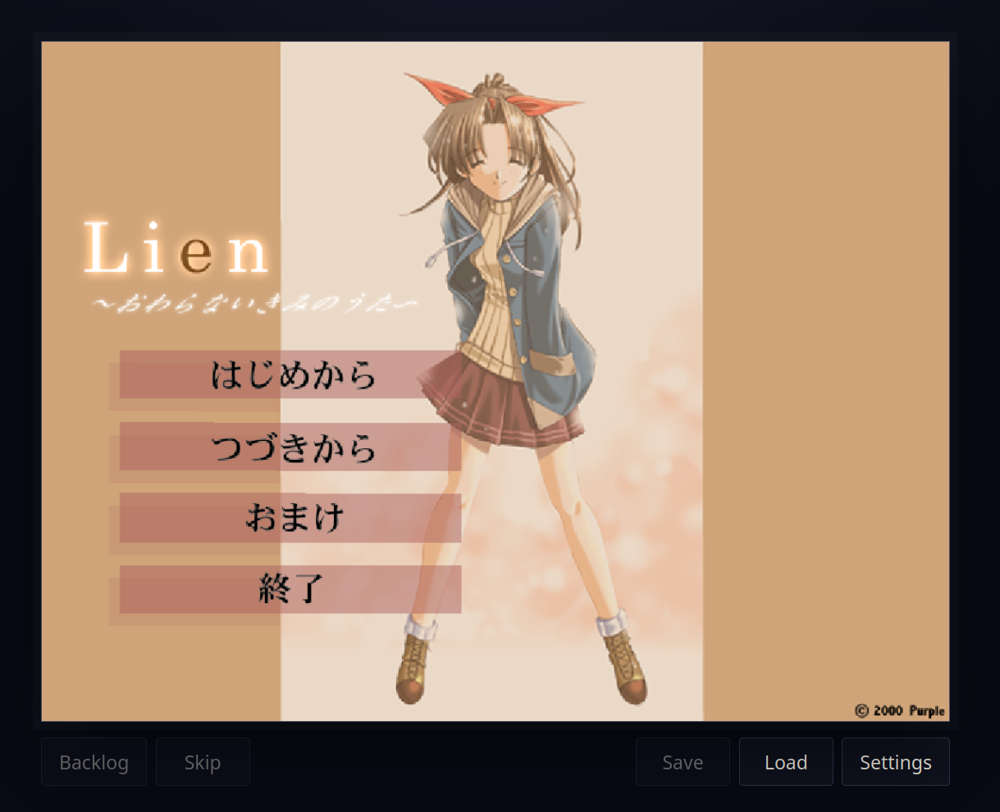
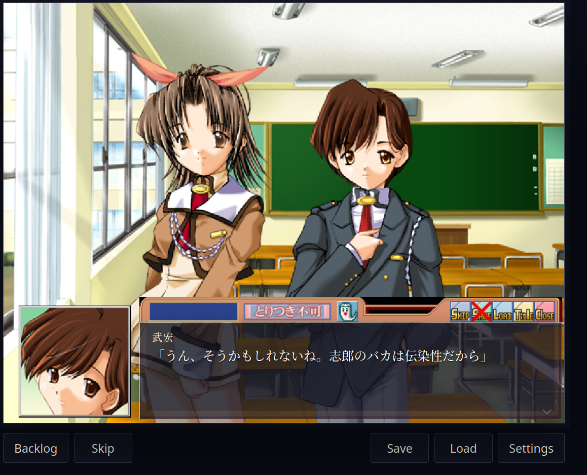
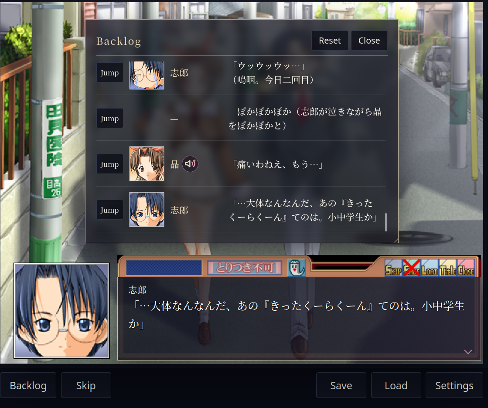
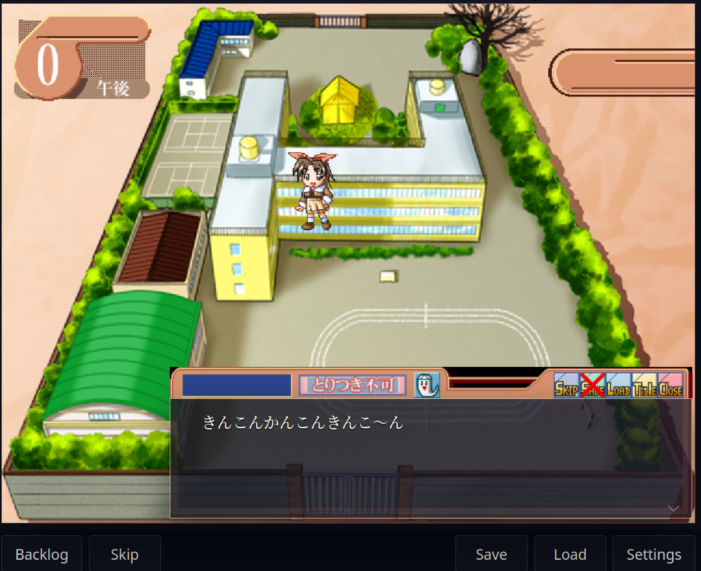
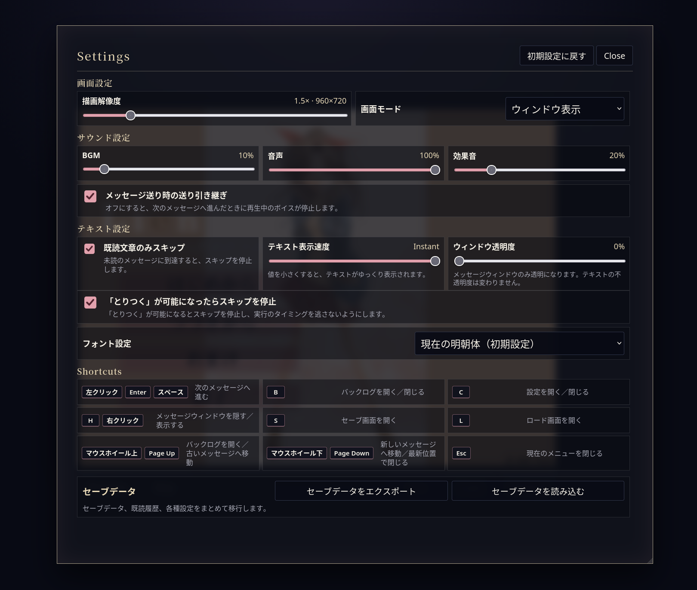
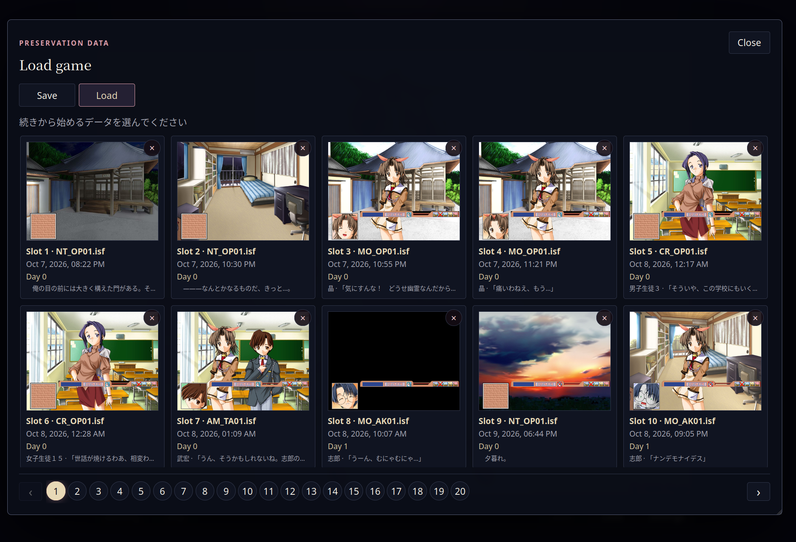

# Lien Web Browser Port

[English](README.md) | [日本語](README.ja.md)

**Lien ～終わらない君の唄～** のゲームエンジンをブラウザ向けに再実装したウェブ移植版です。
インストール済みのゲームアーカイブと元のゲーム CD のイメージを、変更やコピーをせずに読み込みます。

## スクリーンショット

| タイトル画面 | 会話画面 |
| --- | --- |
| <a href="docs/screenshots/1.png"></a> | <a href="docs/screenshots/2.png"></a> |
| **バックログ** | **マップ** |
| <a href="docs/screenshots/3.png"></a> | <a href="docs/screenshots/4.png"></a> |
| **設定** | **セーブ・ロード** |
| <a href="docs/screenshots/settings.png"></a> | <a href="docs/screenshots/save.png"></a> |

## 改良点

- 立ち絵アイコン、ボイスの再再生、過去の行へのジャンプに対応したバックログを実装。
- 音量設定と、次の行へ進んでも再生中のボイスを継続する設定を追加。
- マップでの選択時に限らず、どこでもセーブ可能。セーブスロットも追加。
- 既読テキストのみをスキップするオプション付きのスキップボタンを追加。
- ショートカットを拡充。元のゲームでは、テキスト送りは左クリックのみでした。
- テキスト表示速度とメッセージウィンドウの透明度を調整するスライダーを追加。
- 「とりつく」が可能なとき、アイコンが光るように変更。
- 640×480 から 2560×1920 まで、1～4 倍の描画解像度に対応。フルスクリーン表示では最近傍補間で拡大し、ゲーム内テキストはブラウザのネイティブ解像度で描画。
- [アーカイブされた攻略ページ](https://web.archive.org/web/20021212073805/http://www5.ocn.ne.jp:80/~misaki-b/kouryaku/lien.htm)を基に、ゲーム全編の HTML 攻略ガイドを追加。
- TODO: 自動攻略のルート選択とシーンスキップ。

セーブデータはブラウザ内に保存されます。設定画面からローカルファイルへエクスポートできます。

## 実行方法

ゲームデータは、次のいずれかの方法で用意できます。

- CD ファイルから `extract_assets.py` で抽出した、完成済みの `assets/` フォルダー。
- ルートフォルダー内の `lien_inst.img` と `lien_game.img`（名前を変更した `.img` 形式の CD ダンプも可）。アーカイブをイメージから直接識別して読み込むため、抽出は不要です。
- ランチャーと同じ場所に置いたゲームアーカイブ（`DATA`、`GGD`、`ISF`、`SE`、`WMSC`）。
- 環境変数 `LIEN_GAME_DIR` で指定した別のゲームディレクトリ。

### Windows

`Launch Lien.bat` を実行します。
ブラウザが自動で開かない場合は、<http://127.0.0.1:8787/> を開いてください。

### Linux、macOS、開発環境

Python 3.10 以降を使用し、このディレクトリで以下を実行します。

```bash
python3 server.py --open
```

ブラウザが自動で開かない場合は、<http://127.0.0.1:8787/> を開いてください。
サーバーはローカルコンピューターからのみ接続できます。

## アセットの抽出と CD イメージなしでの実行

次のコマンドでアセットを一度だけ抽出します。

```bash
python extract_assets.py --install-image lien_inst.img --game-image lien_game.img
```

各画像、シナリオ、カーソル、効果音、楽曲、ボイスを含む `assets/` フォルダーが作成されます（約 0.8～0.9 GB）。
コマンドが完了したら、`lien-web` フォルダーを単独で移動できます。`server.py` は抽出済みのアセットを自動的に優先します。
`.complete.json` は全ファイルの書き出しが終わってから作成されます。そのため、抽出が途中で中断されても元のゲームデータを使用でき、コマンドを再実行して抽出を再開できます。

## テスト

```bash
python -m unittest discover -s tests -v
```

## クレジット

**Lien ～終わらない君の唄～** は、JAST（[ジャスト](https://ja.wikipedia.org/wiki/ジャスト_(ブランド))）のブランドである Purple（パープル）によって開発・発売されました。

ウェブランタイムと移植版の開発: GPT-5.6-Sol。

HTML 攻略ガイドは、[アーカイブに保存された元の攻略ページ](https://web.archive.org/web/20021212073805/http://www5.ocn.ne.jp/~misaki-b/kouryaku/lien.htm)を基に編集しました。

同梱の明朝体および MS ゴシック風の設定には、Noto Serif CJK JP と Noto Sans Mono CJK JP からゲームで使用する文字を収録したフォントを使用しています。これらは SIL Open Font License 1.1 に基づいて配布されています。ライセンス本文は `web/fonts/OFL-1.1.txt` にあります。

Windows 版には、Python Software Foundation License に基づいて配布される CPython 3.10.11 の組み込み用ランタイムが含まれています。ライセンスとサードパーティーの告知は `python/LICENSE.txt` にあります。

元のゲームの画像、音声、シナリオ、キャラクター、名称、商標に関する権利は、それぞれの権利者に帰属します。ウェブランタイムに適用されるライセンスの対象には含まれません。
